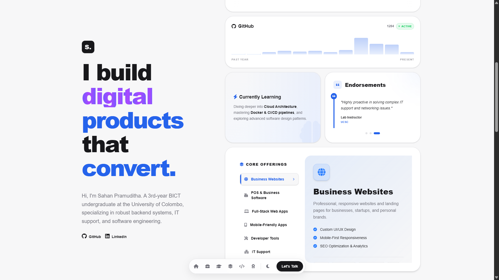
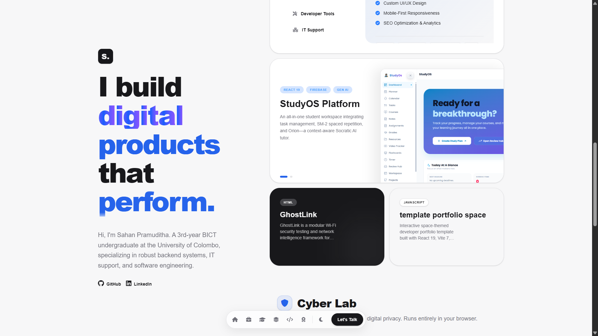
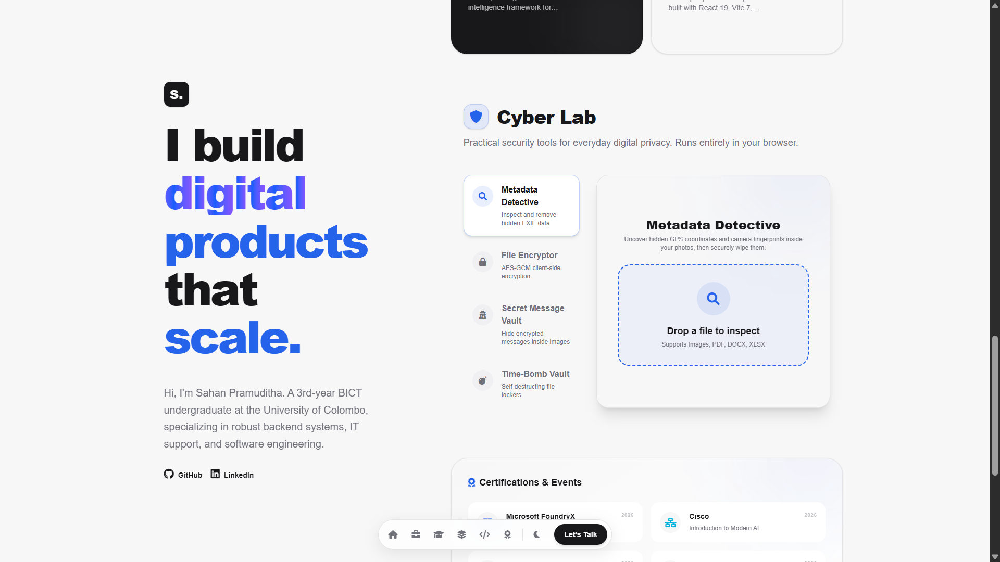
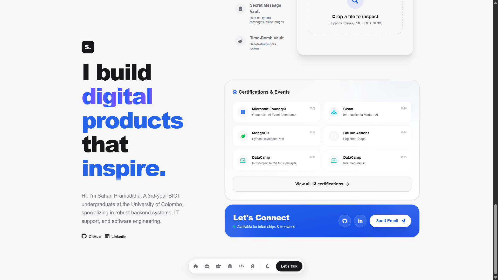
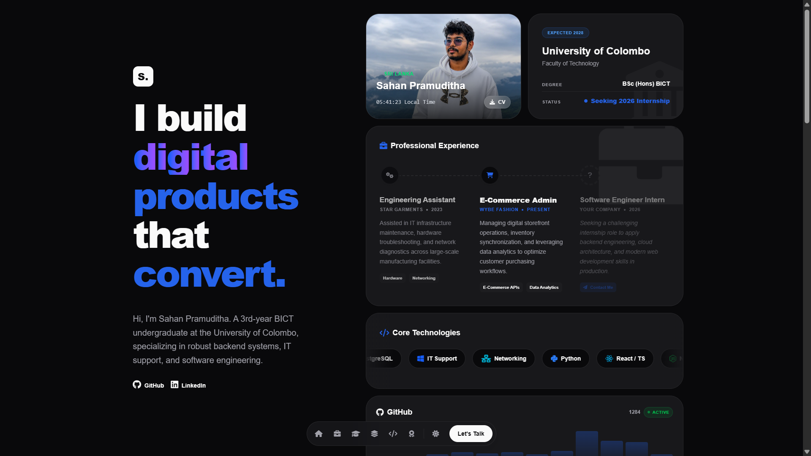
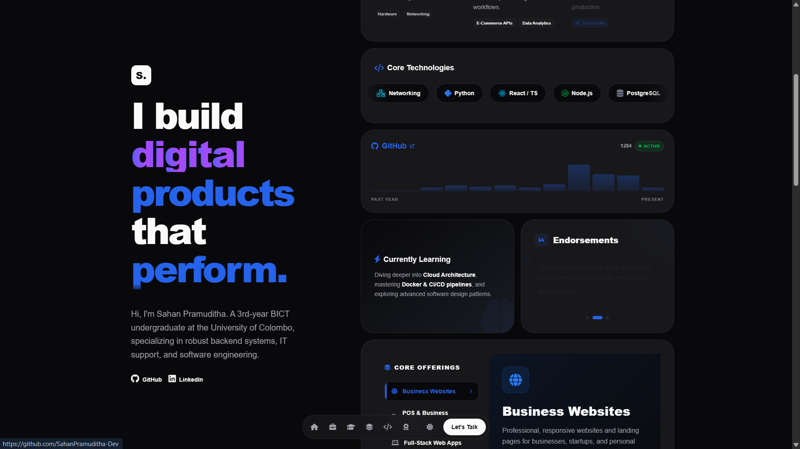
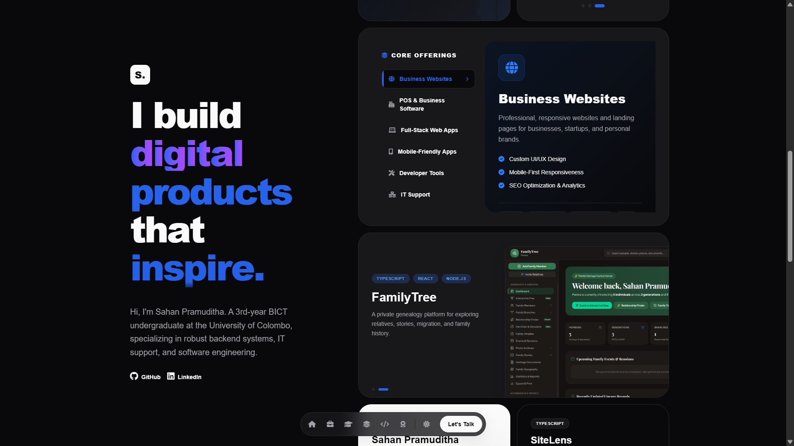
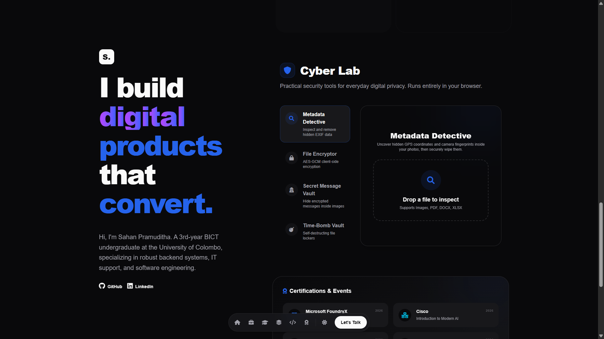
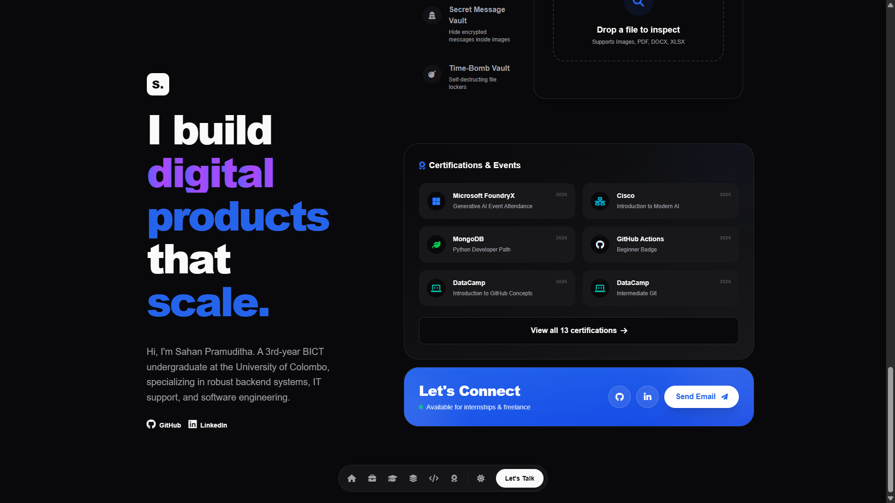
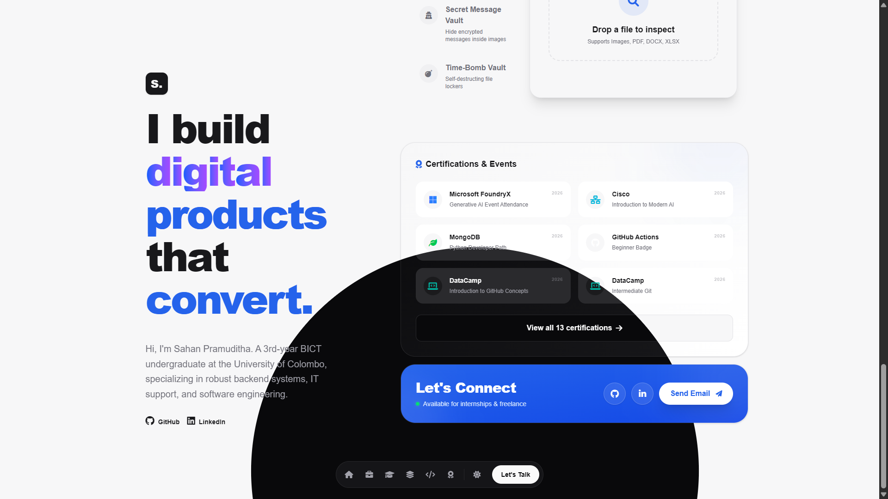

# Sahan Pramuditha — Personal Portfolio


A responsive personal portfolio for **Sahan Pramuditha**, an undergraduate software engineer focused on backend systems, cloud architecture, IT support, and practical product development.

The site combines a clean bento-style interface with interactive project previews, career and education timelines, certifications, a downloadable resume, theme switching, and a browser-based Cyber Lab.

## Highlights

- Responsive portfolio experience for desktop and mobile screens
- Light and dark themes with animated view transitions
- Interactive experience, education, certifications, and projects sections
- Downloadable resume and contact call-to-action
- Cyber Lab utilities for file encryption, metadata inspection, secret messages, and time-based vaults
- Firebase-backed content for portfolio status and certifications
- Accessible, component-driven React UI with reusable interaction patterns

## Screenshots

| Portfolio views | Portfolio views |
| --- | --- |
|  |  |
|  |  |
|  |  |
|  |  |
|  |  |
|  |  |

## Tech stack

- **Frontend:** React 19, TypeScript
- **Build tooling:** Vite
- **Styling:** Tailwind CSS v4 and custom CSS
- **Animation:** Framer Motion and the View Transitions API
- **Icons:** Lucide React and Font Awesome
- **Backend services:** Firebase Authentication, Firestore, and Analytics
- **Utilities:** JSZip, PDF-Lib, EXIFR, LZ-String, and UUID

## Getting started

### Prerequisites

- Node.js 20 or newer
- npm 10 or newer

### Installation

```bash
git clone https://github.com/SahanPramuditha-Dev/Sahan-Pramuditha.git
cd Sahan-Pramuditha
npm install
```

### Development

```bash
npm run dev
```

Vite will start the local development server and print the URL in the terminal.

### Production build

```bash
npm run lint
npm run build
npm run preview
```

## Project structure

```text
src/
├── components/CyberLab/   Cyber Lab tools and supporting controls
├── AdminDashboard.tsx     Portfolio content administration
├── App.tsx                Main portfolio experience
├── App.css                Component and layout styles
└── firebase.ts            Firebase client configuration
public/                    Images, logos, favicon, and downloadable resume
screenshots/               README gallery assets
```

## Deployment

The application is a static Vite site and can be deployed to any host that supports static assets, including Vercel, Netlify, GitHub Pages, or Firebase Hosting.

```bash
npm run build
```

Deploy the generated `dist/` directory with the hosting provider of your choice.

## License

This project is maintained as a personal portfolio. Unless otherwise stated, the source code and visual assets are not licensed for redistribution.
